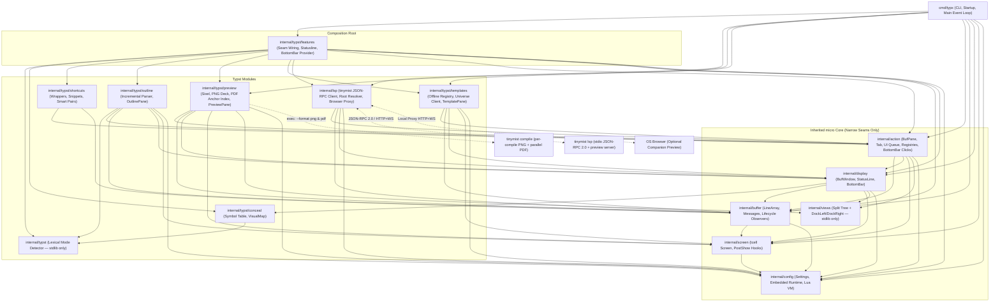

# TypX — System Architecture (`ARCHITECTURE.md`)

TypX is a single-binary Go terminal editor for [Typst](https://typst.app/), forked from **`zyedidia/micro` (`v2.0.15`)**. Typst modules (`internal/typst/*`, `internal/lsp`) stay decoupled from one another and integrate into `micro` through narrow **seams** wired in one composition root (`internal/typst/features`), while delegating Typst compilation, semantic analysis, and live preview rendering to an out-of-process **`tinymist`** binary.

---

## 1. Module & Dependency Graph

Solid arrows (`-->`) denote Go compile-time imports (`A --> B` means `A` imports `B`). Dashed arrows (`-.->`) denote out-of-process stdio/HTTP IPC or spawned CLI compiles.

---

## 2. Lifecycle Ordering: Startup, Event Loop & Teardown

Filesystem inspection does not reveal runtime ordering constraints; these sequences are load-bearing:

1. **Config Directory Precedence (`internal/config/config.go`)**:
   `-config-dir` flag → `TYPX_CONFIG_HOME` → `<os.UserConfigDir()>/typx` → `~/.config/typx`.
2. **Startup Sequence (`cmd/typx/typx.go`)**:
   - Parse flags (`-check`, `-no-lsp`, `-preview`, `-new`, `-config-dir`, and dynamic `-<option>` overrides) and initialize config/settings.
   - If `-check`, run `runCheck` (bounded `tinymist` version probe + environment check) and exit without touching the terminal screen.
   - If `-new <template>`, run `handleNewFlag` (printing template catalog on `-new list` and exiting, or scaffolding personal/project/package files non-destructively and passing the created entrypoint to `lsp.Init` and `LoadInput`).
   - Call **`preview.ProbeTerminal()` *before* `screen.Init()`**: terminal capability/cell-pixel queries read stdin/stdout directly before `tcell` takes ownership of the TTY.
   - Initialize `screen`, clipboard, and `config.LoadAllPlugins()`.
   - Run **`features.Init()`** *before* **`lsp.Init(lsp.Options{StartPreview, InitialFiles})`**: `features.Init()` installs `lsp.SetInlinePreviewHandler`, which `lsp.ShouldUseInlinePreview()` reads to decide whether `-preview` opens inline or in the browser. Passing `InitialFiles` lets LSP resolve the Typst project root before `LoadInput` runs.
   - Run `action.InitBindings()` → `action.InitCommands()` → plugin `preinit` → `action.InitGlobals()` → `LoadInput(args)` → `action.InitTabs(b)`.
   - If `-preview` and inline preview is selected, open `preview.Open(cp, false)` on the active `.typ` `BufPane` now that tabs exist.
   - Run plugin `init` → `postinit` → `config.InitColorscheme()` → `StartAutoSave()`, then enter `DoEvent()`.
3. **Single `DoEvent()` Iteration (`cmd/typx/typx.go`)**:
   1. `buffer.FlushObservers()` — delivers coalesced edits/cursor moves before rendering so conceal caches, outline highlights, and LSP state reflect the current frame.
   2. Render all panes, tabs, and `InfoBar` → `screen.Screen.Show()` → **`screen.RunPostShowHooks()`** (emits Sixel frames *after* `tcell` cell diffing completes).
   3. Block on `select` across shell jobs, autosave, `screen.Events`, `screen.DrawChan()`, **`action.UIQueueReady()`** (`action.DrainUIQueue()`), and termination signals.
   4. Dispatch terminal events in precedence order: `EventResize` → active `InfoBar` prompt → **`action.HandleBottomBarEvent`** (bottom bar / `Alt+G` key menu) → `action.Tabs.HandleEvent`.
4. **Teardown (`exit(rc)` in `cmd/typx/typx.go`)**:
   `preview.Shutdown()` (cancels active compiles, cleans temp PNG/PDF dirs) → `lsp.Shutdown()` (terminates `tinymist` LSP/preview subprocesses, reinforced on Windows by Job Objects) → `b.Fini()` on unmodified buffers → `screen.Screen.Fini()`.

---

## 3. Seams into `zyedidia/micro`

To keep upstream `micro` diffs minimal and localized, TypX interacts with `micro` core through seven narrow seams:

| Seam | Location | Interface & Invariant |
| --- | --- | --- |
| **Main-Loop UI Queue** | `internal/action/uiqueue.go` | `action.EnqueueUI(func())` schedules callbacks onto the main goroutine (drained in `DoEvent()`). All worker goroutines marshal buffer, pane, tab, `InfoBar`, and screen mutations through this seam. |
| **Buffer Lifecycle Observers** | `internal/buffer/hooks.go` | `buffer.RegisterObserver(Observer)` delivers `OnBufferOpen`, `OnBufferChange`, `OnBufferSave`, `OnBufferClose`, and `OnCursorMove` synchronously on the main goroutine. Changes and cursor moves coalesce per frame (changes always precede cursor moves and flush before save/close). Key per-document state on `b.SharedBuffer` or `b.AbsPath` and check `b.Shared()` on close; `OnBufferClose` is not guaranteed on `SIGTERM`/panic. |
| **Extension Registries & Input Hooks** | `internal/action/extension.go` | `RegisterCommand`, `RegisterAction`, `RegisterDefaultBinding` (precedence: user `bindings.json` > TypX default > `micro` default), `RegisterRuneHook`, and `RegisterPreActionHook` (`Backspace`, `InsertNewline`). Registration panics on duplicates so collisions fail loudly in tests. |
| **Statusline & Bottom Bar** | `internal/display/statusline.go`, `internal/display/bottombar.go`, `internal/action/bottombar.go` | `display.SetStatusInfoFn` feeds `$(typst.mode)`, `$(typst.words)`, and `$(typst.lsp)`. `display.SetBottomBarProvider` supplies context hints and `Alt+G` menu rows; `action.HandleBottomBarEvent` intercepts clicks and menu keys before pane dispatch. |
| **Display-Only Concealment** | `internal/display/bufwindow.go`, `internal/display/softwrap.go` | `BufWindow` renders `conceal.LineView` glyphs on `.typ` buffers without altering buffer bytes, and `LocFromVisual` maps clicks/visual coordinates back to buffer rune indices via `LineView.VisualToBuf`. |
| **Docked Split Panes** | `internal/views/splits.go` | `Node.DockLeft(width)` (fixed-width Outline) and `Node.DockRight(width)` (proportional Preview) attach auxiliary panes alongside normal editor splits. |
| **Post-Show Graphics** | `internal/screen/screen.go` | `screen.RegisterPostShowHook` runs after `tcell.Screen.Show()` so raw terminal graphics (Sixel) paint over reserved cells without `tcell` overwriting them. |

---

## 4. Cross-Module Seams & Composition Root

`internal/typst/features/features.go` (`features.Init()`) is the single composition root that wires TypX's decoupled modules together. Each seam keeps the owning module deep and testable with fake adapters:

| Seam | Interface | Production Adapter (`features.Init()`) | Purpose |
| --- | --- | --- | --- |
| `lsp.SetInlinePreviewHandler` | `lsp.InlinePreviewHandler` (`SupportsInline`, `IsOpen`, `Open`, `Toggle`, `Close`, `ToggleInvert`, `ToggleTrim`) | `inlinePreviewAdapter` delegating to `internal/typst/preview` | Routes `:preview` / `Alt+P` / `--preview` between inline Sixel preview and browser preview without `lsp` ↔ `preview` imports. |
| `preview.SetCompiler` | `preview.Compiler` (`CompilePages(ctx, CompileRequest) (*DocumentDeck, error)`) | `&preview.TinymistCompiler{...}` (swapped for fakes in tests) | Isolates PNG/PDF subprocess compilation from `PreviewPane` state and viewport rendering. |
| `preview.TinymistCompiler.DiscoverFn` & `preview.SetRootResolver` | `TinymistDiscoveryFunc`, `RootResolverFunc` | `lsp.Discover` and `lsp.FindProjectRoot` | Reuses LSP binary discovery and multi-file root resolution without importing `internal/lsp`. |
| `outline.SetSymbolProvider` | `outline.SymbolProvider` | `lsp.RequestDocumentSymbols` → `convertLSPSymbols` | Enriches the pure-Go outline parser with `tinymist` `textDocument/documentSymbol` results when LSP is active. |
| `outline.SetJumpHandler` | `outline.JumpHandler` | `syncPreviewToOutlineItem` → `preview.PreviewPane.ScrollToSection` & `lsp.ScrollPreviewTo` | Repositions inline Sixel and/or browser preview when an outline entry is selected without coupling `outline` to `preview` or `lsp`. |
| `templates.SetExternalBackend`, `templates.SetRootResolver` & `templates.SetPreviewProvider` | `templates.ExternalBackend`, `func(string) string`, `templates.PreviewProvider` | `lspTemplateAdapter`, `lsp.FindProjectRoot`, `previewTemplateAdapter` | Lets `TemplatePane` scaffold `@preview`/`@local` packages via `tinymist` and render live gallery previews in `PreviewPane` without importing `internal/lsp` or `internal/typst/preview`. |
| `shortcuts.SetModeDetector` | `func(lines [][]byte, line, col int) shortcuts.Mode` | `typst.DetectModeAt` (with rune-to-character cluster column mapping) | Injects canonical lexical mode detection into `shortcuts` (note: `shortcuts/mode.go` retains a standalone fallback; `internal/typst` is stdlib-only, so this seam is historical rather than cycle-required). |

---

## 5. Modules (Interface, Implementation & Invariants)

### 5.1 Lexical Mode & Concealment (`internal/typst`, `internal/typst/conceal`)

- **Interface**: `typst.ScanLineState` / `DetectModeAtLine` / `DetectModeAt` (cached per-line lexical state: `Markup`, `Math`, `Code`, `Raw`); `conceal.BuildLineView` returning `LineView` with `VisualToBuf` / `BufToVisual`; `conceal.ToggleSetting`.
- **Implementation**: Line-entry state caching tracks multi-line `$ ... $` blocks and raw fences in `O(1)` per visible line. Longest-match symbol scanning covers Unicode math symbols, operators (`->`, `<=`, `!=`), and compound dotted Typst identifiers (`in.not`, `subset.eq.not`, `inter.big`) while enforcing non-identifier boundaries so words like `sin`, `index`, or `summary` stay intact.
- **Invariants**:
  - Concealment is strictly display-only and never mutates buffer bytes.
  - Active cursor line (default `typst.concealMode == "line"`) or active token (`"token"`) bypasses concealment.
  - Register compound dotted Typst math symbols explicitly in `internal/typst/conceal/symbols.go` so longest-match scanning does not split prefixes like `in` inside `in.not`.

### 5.2 `tinymist` LSP & Browser Preview (`internal/lsp`)

- **Interface**: `lsp.Init(Options)`, `lsp.Shutdown()`, `lsp.Check(io.Writer)`, `lsp.Discover`, `lsp.FindProjectRoot`, `lsp.RequestDocumentSymbols`, `lsp.ScrollPreviewTo`, `lsp.InitTemplate`, `lsp.GetTemplateEntry`, `lsp.IsPreviewActive`, `lsp.ShouldUseInlinePreview`, plus commands/actions (`:preview`, `:diagnostics`, `:tinymist-status`, `:tinymist-restart`, `:hover`, `:lsp-complete`).
- **Implementation**:
  - Binary discovery checks `typst.tinymistPath`, `PATH`, and OS-specific install paths (WinGet, Scoop, Cargo, Homebrew, `~/.local/bin`, VS Code extensions). Startup reads `ServerInfo.Version` from the LSP `initialize` response rather than running a blocking `--version` probe.
  - Stdio JSON-RPC 2.0 transport (`Content-Length` framing) with dedicated reader/writer goroutines, UTF-16 ↔ rune column conversion, debounced document sync, and a stderr ring buffer surfaced via `:tinymist-status`.
  - `FindProjectRoot` resolves multi-file project roots in order: `typst.toml` → ancestor matching `#import "/..."` → `.git` → `../` depth → file directory.
  - Companion browser preview launches `tinymist.doStartPreview` (`--no-open`, `--task-id`, `--partial-rendering true`, `--root`) fronted by a local HTTP/WebSocket proxy that injects compile-progress overlays and ETag/prefetch caching.
- **Invariants**:
  - Offline editing works cleanly when `tinymist` is absent or `--no-lsp` is set.
  - `tinymist.doStartPreview`, `tinymist.scrollPreview`, and `tinymist.doKillPreview` require the explicit task ID string as `args[0]`.
  - Child processes never leak stdout/stderr onto the `tcell` screen and are reaped on exit (including Windows Job Objects with `JOB_OBJECT_LIMIT_KILL_ON_JOB_CLOSE`).

### 5.3 Native In-Terminal Sixel Preview & PDF Anchor Sync (`internal/typst/preview`)

- **Interface**: `preview.ProbeTerminal`, `preview.SupportsSixel`, `preview.Init`, `preview.Shutdown`, `preview.Open` / `Toggle` / `CloseForTab` / `PaneForTab`, `preview.OpenForOverride` / `ClearOverrideForTab` / `CompileTypstToImages`, `PreviewPane.ScrollToSection(SectionTarget)`, `DocumentDeck.ResolveSectionScrollY`, and `ParsePDFAnchors([]byte) *DocumentAnchors`.
- **Implementation**:
  - **Terminal probe**: Cross-platform Sixel & cell-pixel detection (CSI `16t`/`14t`, DA1, `TIOCGWINSZ`, Windows Terminal / Konsole / foot / WezTerm / xterm).
  - **Parallel PNG + PDF compile (`TinymistCompiler.CompilePages`)**: Stages unsaved buffers to a sibling shadow file so relative/root imports still resolve, runs `tinymist compile --format png` for per-page raster images, and in parallel runs a non-fatal `tinymist compile --format pdf` to extract rendered coordinates via the zero-dependency PDF parser (`ParsePDFAnchors`, walking `/Pages`, `/Names /Dests`, and `/Outlines`).
  - **Three-tier section jump (`ResolveSectionScrollY`)**: Resolves an outline target to a continuous pixel `scrollY` (accounting for margin trimming) via (1) exact `<label>` named destination from `/Names /Dests`, (2) DP monotonic alignment of source headings against PDF `/Outlines` bookmarks (with 1-to-1 sandwiched-gap filling for math/macro headings), and (3) bracketed interpolation between surrounding PDF anchors or proportional buffer-line fallback.
  - **Continuous deck, override mode & Sixel output**: Lazily decodes visible pages, resamples with Catmull-Rom filtering (`golang.org/x/image/draw`), encodes 248-color RLE Sixel streams, and supports clamped scrolling, zoom, margin trimming, dark-mode inversion, keyboard (`<`/`>`) + mouse-drag width resizing inside a `DockRight` pane, and temporary override decks for Template Gallery live preview (restoring any pre-existing document deck and scroll position on exit).
- **Invariants**:
  - Set `cmd.Dir = rootDir` alongside `--root` when invoking `tinymist compile` so Windows relative ancestor checks do not fail.
  - Capture `canceled := ctx.Err() == context.Canceled` *before* calling `cancel()` when dispatching compile results to `action.EnqueueUI`.
  - On Windows ConPTY, any preview geometry shift, pane close, tab switch, or divider drag start triggers `pendingSync` and wipes atomically inside DEC Mode 2026 (`\x1b[?2026h` + `\x1b[0m\x1b[2J` → `screen.Screen.Sync()` → Sixel emit → `\x1b[?2026l`). Always reset SGR (`\x1b[0m`) before clearing Sixel regions and defer Sixel redraws while `tab.IsResizing()` is true.

### 5.4 Document Outline Sidebar (`internal/typst/outline`)

- **Interface**: `outline.Init`, `outline.SetSymbolProvider`, `outline.SetJumpHandler`, `outline.EffectiveWidth`, and `OutlinePane` (`action.Pane`, `action.AuxiliaryPane`, `display.Window`).
- **Implementation**: Pure-Go incremental parser extracts `= Headings`, `#figure(...)` captions, and `<label>` anchors while skipping raw fences and nested `/* ... */` comments (switching to async snapshot parsing above 5,000 lines), optionally enriched by LSP symbols. Renders in a `DockLeft` pane (`Alt+O` / `:outline`) with live cursor tracking, jump-and-center, interactive `/` filtering, and `JumpHandler` dispatch to preview sync.
- **Invariants**:
  - `micro` stores `cursor-line`'s highlight color in the foreground slot — decompose `fg` and apply `.Background(fg)` for active outline rows.
  - Enforce minimum width clamping (`EffectiveWidth`) so the sidebar hides cleanly below `MinTerminalWidth` (50 columns) without starving editor panes.

### 5.5 Shortcuts, Bottom Bar & Bundled Plugins (`internal/typst/shortcuts`, `internal/typst/features`, `runtime/plugins/`)

- **Interface**: `shortcuts.RegisterAll`, `shortcuts.HandleTypstRune` / `HandleTypstBackspace` / `HandleTypstNewline`; `features.Init` (wires statusline `$(typst.mode)` / `$(typst.words)` caches and `buildBottomBarContext`).
- **Implementation**:
  - Context-aware math/markup actions (`Alt+M`, `Alt+Shift+M`, `Alt+B`, `Alt+E`, `Alt+Left`/`Alt+Right`), indentation-aware `$0` snippet templates (`:insert` / `Alt+I`), and mode-aware smart pairing (`$`, `[`, `(`, `{`, `"`).
  - Priority-filtered, mouse-clickable bottom bar + `Alt+G` key menu tailored to active context (Markup, Math, Code, Outline, Preview, Files, Help) with live toggle indicators and clickable diagnostic pills.
  - Bundled MIT-licensed `filemanager` plugin (`Alt+T` / `:tree`) and Typst-guarded `autoclose` plugin.
- **Invariants**:
  - Preserve `altShiftFallbackKeyEvents` (`internal/action/events.go`) so Windows ConPTY `ModAlt | ModShift` events match uppercase `Alt-M` bindings.
  - In bundled Lua plugins: close `*os.File` handles from `os.Create` (prevents Windows locks), use `LocFromVisual`, and keep `autoclose.lua` yielding on `.typ` buffers when `typst.smartPairs` is enabled.
  - Statuslines, preview footers, and the bottom bar must compact or drop low-priority items gracefully in narrow 3-pane layouts.

### 5.6 Template Gallery & Project Scaffolding (`internal/typst/templates`)

- **Interface**: `templates.Init`, `templates.SetExternalBackend`, `templates.SetRootResolver`, `templates.SetPreviewProvider`, `templates.DiscoverOffline`, `templates.ResolveByName`, `templates.ScaffoldToFile`, `templates.ScaffoldToDir`, `templates.SavePersonalTemplate`, `UniverseClient`, `TemplatePane` (`action.Pane`, `action.AuxiliaryPane`, `display.Window`), plus commands/actions (`:templates`, `:template`, `:template-save`, `ToggleTemplates` / `Alt+Shift+N`).
- **Implementation**:
  - Offline registry scans project-local (`.typx/templates/`), personal (`<ConfigDir>/templates/`), and OS Typst `@local` / cached `@preview` package directories (with a pure-Go `typst.toml` parser, never invoking `tinymist.getResources([])`).
  - `UniverseClient` loads and caches Typst Universe `@preview/index.json` only on demand (ETag + 24h TTL stripped cache) and provides a zip-slip-guarded `.tar.gz` extraction fallback into Typst's package cache directory.
  - `TemplatePane` renders grouped template sections in a `DockLeft` pane with `/` live filtering, `cursor-line` fg-as-bg selection highlighting, 3-row footer preview, default-on debounced live visual preview in Sixel terminals (full-res `.webp` Typst Universe thumbnail decode with `-small.webp` 404 fallback, opaque paper-white compositing, Catmull-Rom Sixel scaling via `golang.org/x/image/draw`, and SHA-256 PNG cache for personal/project templates; `v` toggle or read-only `.typ` source fallback), and async `tinymist.doInitTemplate` / `tinymist.doGetTemplateEntry` execution marshaling UI updates via `action.EnqueueUI`.
- **Invariants**:
  - Never perform network calls at startup; all Universe/package operations run off the main loop and capture `canceled := ctx.Err() == context.Canceled` before `cancel()`.
  - Never overwrite non-empty destination files or directories unless explicitly forced/confirmed, and reject symlink/parent-traversal tar entries.
  - Bind uppercase `Alt-N` only (`Alt-n` remains `micro`'s `SpawnMultiCursor`), and promote the `Templates` bottom bar hint only while the active `.typ` buffer is blank.

---

## 6. Import Dependency Rules

Verified against `go list ./...`. Route new cross-module interactions through `internal/typst/features` seams rather than adding direct imports:

- **`internal/typst` (`mode.go`) & `internal/views`**: Remain stdlib-only.
- **`internal/typst/conceal`**: Imports only `internal/typst` and `internal/util` (never `internal/action` or `internal/display`, since `display` imports `conceal`).
- **`internal/lsp`, `internal/typst/preview`, `internal/typst/outline`, `internal/typst/templates`**: Never import one another directly; coordinate through `features.Init()` seams (`InlinePreviewHandler`, `Compiler`/discovery/root resolver, `SymbolProvider`, `JumpHandler`, `ExternalBackend`, `SetRootResolver`, `PreviewProvider`).
- **Inherited `micro` core (`action`, `buffer`, `config`, `display`, `screen`, `views`)**: Never import `internal/lsp`, `internal/typst/features`, `outline`, `preview`, `shortcuts`, or `templates`. The sole Typst import inside `micro` core is `internal/display` → `internal/typst/conceal`.
