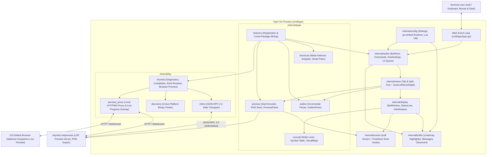

# TypX — System Architecture (`ARCHITECTURE.md`)

## 1. High-Level System Architecture

TypX is a single-binary Go terminal application forked from **`zyedidia/micro` (`v2.0.15`)**. Typst-native features live in modular Go packages (`internal/typst/*` and `internal/lsp/*`) that integrate into `micro`'s buffer, rendering, action, and split-pane layers through narrow hooks, while delegating Typst compilation, semantic analysis, and live preview rendering to an out-of-process **`tinymist`** binary.



---

## 2. Repository & Package Layout

```text
TypX/
├── cmd/
│   └── typx/                     # CLI flags (--check, --no-lsp, --preview), startup, main event loop
├── internal/
│   ├── action/                   # BufPane, Tab, keybinding dispatch, UI callback queue, extension registry
│   ├── buffer/                   # LineArray, EventHandler, Messages/Gutter, Observer lifecycle hooks
│   ├── clipboard/                # Upstream micro clipboard integration
│   ├── config/                   # TypX config dir, typst.* settings, trimmed embedded runtime assets
│   ├── display/                  # BufWindow (concealment render hook), UIWindow, StatusLine providers
│   ├── lsp/                      # Lightweight Go LSP client & browser preview orchestration for tinymist
│   │   ├── client.go             # JSON-RPC 2.0 Content-Length transport, request correlation, stderr ring
│   │   ├── discovery.go          # Cross-platform tinymist binary resolution & version probe
│   │   ├── protocol.go           # Minimal LSP 3.17 structs + UTF-16 <-> rune column conversion
│   │   ├── tinymist.go           # Debounced doc sync, multi-file project root resolution, diagnostics/hover/completion
│   │   ├── preview_proxy.go      # Local proxy for tinymist browser preview with live compile status & caching
│   │   ├── browser.go            # Cross-platform URL opener (cmd/start, open, xdg-open)
│   │   ├── job_windows.go        # Windows Job Object subprocess cleanup (JOB_OBJECT_LIMIT_KILL_ON_JOB_CLOSE)
│   │   └── lsp.go                # Public Init/Shutdown/Check entry points & InlinePreviewHandler bridge
│   ├── screen/                   # tcell screen wrapper + PostShow hooks for Sixel output
│   ├── shell/                    # Upstream micro shell/terminal integration
│   ├── typst/                    # Pure-Go Typst editing, outline, and in-terminal preview packages
│   │   ├── mode.go               # Cached O(1) lexical mode detector (Markup / Math / Code / Raw)
│   │   ├── features/             # Central wiring of Typst commands, actions, outline, and preview
│   │   ├── conceal/              # Unicode symbol table, word-boundary-safe scanner, VisualMap
│   │   ├── outline/              # Incremental heading/figure/label parser + left-docked OutlinePane
│   │   ├── preview/              # Cross-platform Sixel capability probe, PNG deck, right-docked PreviewPane
│   │   └── shortcuts/            # Math/markup wrappers, snippet templates, smart pairing
│   └── views/                    # Micro split-pane layout tree (extended with DockLeft / DockRight splits)
├── runtime/
│   ├── syntax/                   # Trimmed: typst, bibtex, markdown, yaml, toml, json, ini, patch, micro, default
│   ├── colorschemes/             # typx-dark, typx-light, and core micro colorschemes
│   ├── help/                     # Built-in TypX help topics (including typst.md)
│   └── plugins/                  # Preserved core Lua plugins
├── samples/                      # Showcase demo.typ document
├── tests/e2e/                    # Headless editor & CLI E2E suites + mocktinymist test server
├── tools/                        # Build metadata helpers (build-date.go, info-plist.go, testgen.go)
├── go.mod                        # module github.com/monicafaye/TypX
├── AGENTS.md                     # Contributor & AI-agent conventions and invariants
├── ARCHITECTURE.md               # This document
└── README.md                     # User guide, installation, shortcuts, configuration
```

---

## 3. Integration Hooks into `zyedidia/micro`

To keep maintenance predictable and preserve `micro`'s stability, TypX isolates its core integrations to a small set of well-defined hooks:

1. **Startup, Branding & Teardown (`cmd/typx/typx.go`, `internal/config/config.go`)**:
   - Resolves config directory via `TYPX_CONFIG_HOME`, `<os.UserConfigDir()>/typx`, then `~/.config/typx`.
   - Adds `--check`, `--no-lsp`, and `--preview` CLI flags.
   - Startup order: `config.LoadAllPlugins()` -> `features.Init()` -> `lsp.Init(...)` -> `action.InitBindings()` -> `action.InitCommands()` -> `LoadInput()`.
   - `exit(rc)` calls `lsp.Shutdown()` to reap `tinymist` subprocesses across every exit path.

2. **Main-Loop UI Callback Queue (`internal/action/uiqueue.go`)**:
   - `action.EnqueueUI(func())` provides an unbounded, non-blocking, FIFO queue drained on the main goroutine inside `DoEvent()`.
   - **Invariant**: All background goroutines (LSP transport, preview compilation, async outline updates) MUST marshal mutations to `buffer.Buffer`, `display`, `action.Tabs`, `action.InfoBar`, and `tcell.Screen` through `action.EnqueueUI`.

3. **Buffer Lifecycle Observers (`internal/buffer/hooks.go`)**:
   - `buffer.RegisterObserver(Observer)` delivers `OnBufferOpen`, `OnBufferChange`, `OnBufferSave`, `OnBufferClose`, and `OnCursorMove` synchronously on the main goroutine.
   - `OnBufferChange` and `OnCursorMove` coalesce per main-loop iteration (changes always precede cursor moves), and pending changes flush before save/close.

4. **Extension & Statusline Registries (`internal/action/extension.go`, `internal/display/statusline.go`)**:
   - `action.RegisterCommand`, `action.RegisterAction`, and `action.RegisterDefaultBinding` allow TypX features to register without hardcoding into `micro` maps (precedence: user `bindings.json` > TypX default > `micro` default).
   - `display.SetStatusInfoFn` powers `$(typst.mode)`, `$(typst.words)`, and `$(typst.lsp)` statusline segments.

5. **Concealment Rendering Hook (`internal/display/bufwindow.go`, `internal/display/softwrap.go`)**:
   - `BufWindow` renders concealed `conceal.LineView` glyphs on non-active lines (or non-active tokens when `typst.concealMode == "token"`) for `.typ` buffers while bypassing concealment on the active cursor line.
   - `LocFromVisual` maps screen coordinates back to true buffer rune indices through `LineView.VisualToBuf`.

6. **Docked Splits & Post-Show Graphics (`internal/views/splits.go`, `internal/screen/screen.go`)**:
   - `views.Node` supports fixed-width `DockLeft` (Document Outline) and proportional `DockRight` (in-terminal Sixel Preview) panes that coexist cleanly with normal editor splits.
   - `screen.RegisterPostShowHook` runs immediately after `tcell.Screen.Show()` so Sixel preview graphics paint cleanly over reserved terminal cells without being clobbered by `tcell` cell updates.

---

## 4. Subsystem Designs

### 4.1 Cursor-Aware Concealment Engine (`internal/typst/conceal`)

TypX avoids cursor/mouse drift by generating an explicit per-line bidirectional coordinate map (`LineView`):

- **Lexical Context**: Uses `internal/typst/mode.go`'s cached line-entry state to detect multi-line `$ ... $` blocks and raw fences in $O(1)$ per visible line.
- **Word-Boundary Safety**: Alphabetic Typst symbols (`alpha`, `in`, `sum`, `dot`) only match on non-identifier boundaries so words like `sin`, `index`, or `summary` are never corrupted. Multi-character operators (`->`, `<=`, `!=`) match greedily by longest prefix.
- **Zero Buffer Mutation**: Saved files always contain exact raw Typst source.
- **Active-Line / Active-Token Unconceal**: Defaults to `"line"` (`typst.concealMode`), bypassing remapping on the line currently being edited.

### 4.2 `tinymist` LSP, Multi-File Roots & Browser Preview (`internal/lsp`)

- **Discovery (`discovery.go`)**: Checks `typst.tinymistPath`, `PATH`, and OS-specific install locations (WinGet, Scoop, Cargo, Homebrew, `~/.local/bin`, VS Code extensions). Startup avoids blocking probes; `typx --check` runs a bounded version check.
- **Transport (`client.go`, `protocol.go`)**: Spawns `tinymist lsp` over stdio JSON-RPC 2.0 (`Content-Length` framing) with dedicated reader/writer goroutines, UTF-16 <-> rune column conversion, and a stderr ring buffer surfaced via `:tinymist-status`.
- **Multi-File Project Root Resolution (`tinymist.go`)**: Resolves the Typst project root (`FindProjectRoot`) by inspecting `typst.toml`, root-relative `/...` imports, `.git`, and relative `../` imports so included chapter/template files compile and lint against the right workspace root.
- **Browser Preview & Local Proxy (`tinymist.go`, `preview_proxy.go`, `browser.go`)**: Launches `tinymist` live preview (with partial rendering and debounced cursor sync) fronted by a local HTTP/WebSocket proxy that injects compile-progress status, supports ETag/prefetch caching, and cleanly tears down child processes on exit (including Windows Job Objects).

### 4.3 Native In-Terminal Sixel Preview (`internal/typst/preview`)

- **Terminal Capability Probe (`terminal.go`, `terminal_unix.go`, `terminal_windows.go`)**: Detects Sixel support and terminal cell pixel dimensions across platforms (CSI `16t`/`14t`, DA1, `TIOCGWINSZ`, Windows Terminal / Konsole / foot / WezTerm / xterm).
- **Continuous Page Deck (`deck.go`, `sixel.go`)**: Compiles document pages via `tinymist` into PNGs, lazily decodes visible pages, scales with a pure-Go box-area filter, encodes 248-color RLE Sixel streams, and supports continuous clamped scrolling, zoom, margin trimming, and dark-mode inversion.
- **Right-Docked Pane (`pane.go`)**: Integrates into the tab split tree via `DockRight`, auto-recompiles on debounced buffer changes, and bridges to `:preview` / `Alt+P` through `lsp.InlinePreviewHandler` (avoiding import cycles between `internal/lsp` and `internal/typst/preview`).

### 4.4 Document Outline Sidebar (`internal/typst/outline`)

- **Incremental Parser (`parser.go`)**: Pure-Go scanner extracting `= Headings`, `#figure(...)` captions, and optional `<label>` anchors while skipping fenced raw blocks and nested `/* ... */` comments; optionally enriched by `tinymist` `textDocument/documentSymbol`.
- **Docked Sidebar (`pane.go`)**: Left-docked pane (`Alt+O` / `:outline`) with live cursor section tracking, keyboard/mouse jump-and-center, and interactive `/` filtering.

### 4.5 LyX-Style Shortcuts & Smart Pairing (`internal/typst/shortcuts`)

- Context-aware commands (`Alt+M`, `Alt+Shift+M`, `Alt+B`, `Alt+E`, `Alt+Left`/`Alt+Right`), indentation-aware `$0` snippet templates (`:insert` / `Alt+I`), and Typst-aware smart pairing (`$`, `[`, `(`, `{`, `"`) guided by `internal/typst/mode.go`.

---

## 5. Package Dependency Rules

To prevent Go import cycles:
- `internal/typst` (`mode.go`) and `internal/typst/conceal` MUST NOT import `internal/action` or `internal/display`.
- `internal/lsp` and `internal/typst/preview` MUST NOT import each other directly; cross-package coordination is wired in `internal/typst/features`.
- Core `micro` packages (`action`, `buffer`, `config`, `display`) MUST NOT import `internal/lsp` or `internal/typst/features`.
