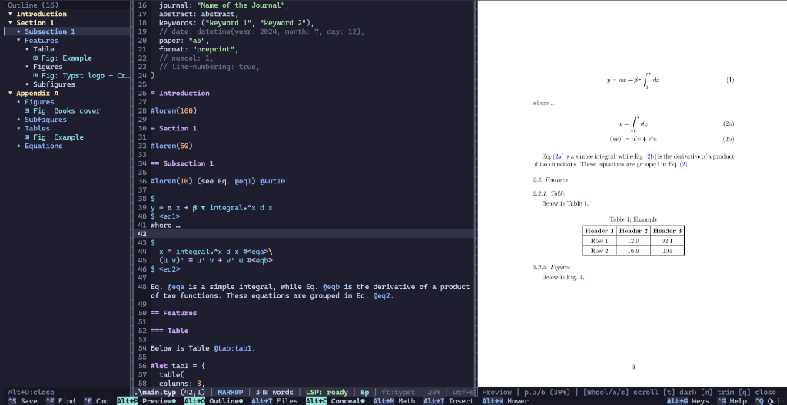

<p align="center">
  
</p>

<h1 align="center">TypX</h1>

<p align="center">
  <a href="https://github.com/monicafaye/TypX/releases"></a>
  <a href="https://typst.app/"></a>
  <a href="LICENSE"></a>
  
</p>

**TypX (`typx`)** is a standalone, lightweight terminal editor for **[Typst](https://typst.app/)**, forked from **[`zyedidia/micro`](https://github.com/zyedidia/micro)**. It brings the terminal Typst workflow many people assemble in Neovim—live math concealment, a document outline, `tinymist` LSP, and side-by-side live preview—into a single ready-to-use binary with standard keybindings and zero plugin setup.

<p align="center">
  <br />
  <sub><em>Document Outline (<code>Alt+O</code>), live Unicode math concealment (<code>Alt+C</code>), and native in-terminal Sixel preview (<code>Alt+P</code>).</em></sub>
</p>

TypX delivers an out-of-the-box Typst authoring workflow in a single fast Go binary:

- **Micro's ergonomics**: familiar keybindings (`Ctrl+S`, `Ctrl+C`, `Ctrl+V`, `Ctrl+Z`, `Ctrl+F`), mouse support, splits, tabs, instant startup, and Lua extensibility.
- **Typst-first syntax & themes**: built-in `typst.yaml` grammar covering Markup, Math, and Code modes, plus dedicated `typx-dark` and `typx-light` colorschemes and companion formats (`bibtex`, `markdown`, `yaml`, `toml`, `json`, `ini`, `patch`).
- **Cursor-aware live Unicode math concealment**: renders Greek letters, arrows, relations, set/logic operators, big operators, simple super/subscripts, and typographic dashes (`---`, `--`, `...`) cleanly on non-cursor lines while unconcealing the active line for exact editing—without ever mutating the underlying `.typ` source.
- **Structural & math shortcuts**: quick inline/display math (`Alt+M` / `Alt+Shift+M`), bold/italic wrappers (`Alt+B` / `Alt+E`), heading promote/demote (`Alt+Left` / `Alt+Right`), indentation-aware snippet templates (`:insert` / `Alt+I`), and Typst-aware smart pairing.
- **Document Outline sidebar**: toggleable docked sidebar (`Alt+O` / `:outline`) powered by a fast incremental pure-Go parser (with optional `tinymist` `textDocument/documentSymbol` enrichment), live cursor tracking, keyboard/mouse jump, and `/` filtering.
- **Integrated File Manager sidebar**: built-in `filemanager` plugin (`Alt+T` / `:tree`) for browsing directories, expanding/collapsing folders inline, opening files in splits, and creating/renaming/deleting files (`:touch`, `:mkdir`, `:rename`, `:rm`).
- **Dual Live Preview (In-Terminal Sixel + Browser)**: native right-docked continuous Sixel preview directly inside Sixel-capable terminals (`Alt+P` / `:preview inline`) with zoom, dark-mode inversion, and margin trimming, plus an auto-reloading companion browser preview (`:preview browser`) with cursor synchronization and compile-progress feedback.
- **`tinymist` LSP & Multi-File Project Support**: automatic project root resolution (`typst.toml`, root-relative `/...` imports, `.git`, `../` imports), gutter diagnostics and `:diagnostics`, completion (`Ctrl+Space`), hover docs (`Alt+K` / `:hover`), and graceful offline operation (`--no-lsp`) when `tinymist` is absent.

---

## Installation

### Prebuilt binaries

Prebuilt archives for `windows/amd64`, `darwin/arm64`, `darwin/amd64`, `linux/amd64`, and `linux/arm64` (with SHA-256 checksums) are published on **[GitHub Releases](https://github.com/monicafaye/TypX/releases)**. Extract the archive and place `typx` (`typx.exe` on Windows) on your `PATH`.

### Building from source

Requires **Go 1.23+**.

```bash
git clone https://github.com/monicafaye/TypX
cd TypX
go generate ./runtime
go build -trimpath ./cmd/typx
```

Or using `make` (runs `go generate ./runtime` and injects version, commit hash, and compile date metadata):

```bash
make build      # builds ./typx (or typx.exe on Windows)
make install    # installs to $GOBIN or $GOPATH/bin
```

### Cross-platform builds

TypX embeds all runtime assets (syntax grammars, colorschemes, help files, and core Lua plugins) via `go:embed` and compiles cleanly with `CGO_ENABLED=0`:

```bash
go generate ./runtime

# Windows (amd64)
GOOS=windows GOARCH=amd64 CGO_ENABLED=0 go build -trimpath -o binaries/typx-windows-amd64.exe ./cmd/typx

# Linux (amd64)
GOOS=linux GOARCH=amd64 CGO_ENABLED=0 go build -trimpath -o binaries/typx-linux-amd64 ./cmd/typx

# macOS (Apple Silicon / Intel)
GOOS=darwin GOARCH=arm64 CGO_ENABLED=0 go build -trimpath -o binaries/typx-darwin-arm64 ./cmd/typx
GOOS=darwin GOARCH=amd64 CGO_ENABLED=0 go build -trimpath -o binaries/typx-darwin-amd64 ./cmd/typx
```

Or build all four targets at once with `make build-cross`.

---

## `tinymist` Setup (LSP & Live Preview)

TypX works fully offline for syntax highlighting, math concealment, structural/math shortcuts, and the Document Outline. Installing **[tinymist](https://github.com/Myriad-Dreamin/tinymist)** unlocks live diagnostics, completion, hover info, outline symbol enrichment, and live preview (both in-terminal Sixel and companion browser preview).

### Install `tinymist`

- **Windows**:
  ```powershell
  winget install Myriad-Dreamin.Tinymist
  # or
  scoop install tinymist
  # or
  cargo install --locked tinymist
  ```
- **macOS**:
  ```bash
  brew install tinymist
  # or
  cargo install --locked tinymist
  ```
- **Linux**:
  ```bash
  cargo install --locked tinymist
  # or download a prebuilt binary from https://github.com/Myriad-Dreamin/tinymist/releases
  ```

### Automatic discovery order

TypX automatically locates `tinymist` (`tinymist.exe` on Windows) in this order:

1. Explicit `typst.tinymistPath` in TypX `settings.json` (or `-typst.tinymistPath <path>` on the CLI).
2. `PATH` (`tinymist` / `tinymist.exe`).
3. Standard OS locations:
   - **Windows**: `%USERPROFILE%\.cargo\bin`, `%LOCALAPPDATA%\Microsoft\WinGet\Links`, `%USERPROFILE%\scoop\shims`, and installed VS Code `myriad-dreamin.tinymist` extensions.
   - **macOS**: `/opt/homebrew/bin`, `/usr/local/bin`, `~/.cargo/bin`, `~/.local/bin`, and VS Code extensions.
   - **Linux**: `~/.cargo/bin`, `~/.local/bin`, `/usr/local/bin`, `/usr/bin`, and VS Code extensions.

Verify your environment (including Sixel terminal detection and `tinymist` discovery) at any time:

```bash
typx --check
```

Inside TypX, run `Ctrl+E` then `tinymist-status` (or `tinymist-restart` to restart the language server).

---

## Quick Start & CLI Usage

Open any `.typ` document with TypX:

```bash
typx paper.typ            # open with LSP, math concealment, and outline
typx --no-lsp paper.typ   # offline mode without starting tinymist
typx --preview paper.typ  # open file and immediately launch live preview
```

### CLI Flags

| Flag | Description |
|---|---|
| `--check` | Verify config directory, embedded Typst syntax, Unicode/Sixel terminal capability, and `tinymist` discovery/version, then exit. |
| `--no-lsp` | Launch without starting `tinymist` (offline mode). |
| `--preview` | Immediately start live preview on the opened `.typ` file (inline Sixel or browser per `typst.previewMode`). |
| `--version` | Show TypX version, upstream `micro` base version, commit hash, and compile date. |
| `--options` | List all configuration options and their default values. |
| `-config-dir <dir>` | Use a custom configuration directory for this session. |
| `-<option> <value>` | Override any option for this session (e.g., `typx -colorscheme typx-dark paper.typ`). |
| `+LINE[:COL]` | Open buffer positioned at a specific line and optional column. |

---

## Default Keybindings & Commands

Press **`Ctrl+E`** to open the command bar (`>` prompt). All TypX keybindings apply in `.typ` buffers (falling back to standard `micro` actions in other file types) and can be customized in `bindings.json`.

### TypX / Typst Shortcuts

| Feature | Command | Default Keybinding | Description |
|---|---|---|---|
| Live Preview | `:preview [inline\|browser\|focus\|invert\|trim\|stop]` | `Alt+P` | Toggle live preview (`auto` chooses in-terminal Sixel when supported, otherwise browser preview). |
| Document Outline | `:outline` | `Alt+O` | Toggle the docked Document Outline sidebar. |
| File Manager | `:tree` | `Alt+T` | Toggle the built-in file tree sidebar (`:touch`, `:mkdir`, `:rename`, `:rm`). |
| Math Concealment | `:conceal [on\|off]` | `Alt+C` | Toggle live Unicode math/symbol concealment in the active buffer. |
| Inline Math | `:math-inline` | `Alt+M` | Insert `$|$`, wrap selection in `$...$`, or exit inline math. |
| Display Math | `:math-display` | `Alt+Shift+M` | Insert a multi-line display math block `$\n  |\n$`. |
| Insert Palette | `:insert [name]` | `Alt+I` | Open the snippet template palette (`figure`, `table`, `frac`, `matrix`, `cases`, `code`, `callout`, `vec`, `hat`, `bar`). |
| Bold | `:wrap-bold` | `Alt+B` | Wrap selection or insert `*bold*` delimiters. |
| Italic | `:wrap-italic` | `Alt+E` | Wrap selection or insert `_italic_` delimiters. |
| Promote Heading | `:heading-promote` | `Alt+Left` | Decrease heading level (`== ` -> `= `). |
| Demote Heading | `:heading-demote` | `Alt+Right` | Increase heading level (`= ` -> `== `). |
| LSP Completion | `:lsp-complete` | `Ctrl+Space` | Trigger `tinymist` autocomplete popup. |
| LSP Hover | `:hover` | `Alt+K` | Show `tinymist` documentation / type info at cursor. |
| Diagnostics List | `:diagnostics` | — | Show all `tinymist` diagnostics for the current `.typ` buffer. |
| Tinymist Status | `:tinymist-status` | — | Display `tinymist` binary path, LSP state, preview URL, and stderr tail. |
| Restart Tinymist | `:tinymist-restart` | — | Restart the `tinymist` language server subprocess. |

Direct snippet commands are also registered for every template: `:insert-figure`, `:insert-table`, `:insert-frac`, `:insert-matrix`, `:insert-cases`, `:insert-code`, `:insert-callout`, `:insert-vec`, `:insert-hat`, and `:insert-bar`.

### In-Terminal Sixel Preview Navigation (`:preview inline` / `:preview focus`)

When the right-docked Sixel preview pane is focused:

| Key / Action | Behavior |
|---|---|
| `Up` / `Down`, `k` / `j`, `w` / `s` | Scroll smoothly up/down through pages. |
| `PgUp` / `PgDn`, `Ctrl+U` / `Ctrl+D`, `Space` | Page up/down through the document. |
| `[` / `]` or `Left` / `Right` | Jump to previous/next page. |
| `g` / `G` or `Home` / `End` | Jump to top or bottom of document. |
| `+` / `-` | Zoom preview in/out. |
| `t` | Toggle dark-mode color inversion (`typst.previewInvert`). |
| `m` | Toggle page margin trimming (`typst.previewTrimMargins`). |
| `r` | Force recompile and redraw preview. |
| `Esc`, `Enter`, `Tab`, `Ctrl+W` | Return focus to the editor pane. |
| `q` or `Alt+P` | Close the preview pane. |

### Document Outline Navigation (`Alt+O`)

When the Document Outline sidebar is focused:

| Key / Action | Behavior |
|---|---|
| `Up` / `Down` or `k` / `j` | Move selection through headings, figures, and (optional) labels. |
| `Home` / `End` / `PgUp` / `PgDn` | Jump to top, bottom, or page through the outline. |
| `Enter` or Mouse Click | Jump the linked editor pane to that item, center the view, and return focus to the editor. |
| `/` | Filter outline entries interactively (`Esc` clears filter, `Enter` confirms). |
| `Esc` or `Tab` | Return focus to the editor without jumping. |
| `Alt+O` or `:outline` | Close the outline sidebar. |

---

## Configuration

TypX resolves its configuration directory in this order:

1. `$TYPX_CONFIG_HOME` (if set)
2. `<os.UserConfigDir()>/typx` (e.g., `%APPDATA%\typx` on Windows, `~/Library/Application Support/typx` on macOS, `$XDG_CONFIG_HOME/typx` or `~/.config/typx` on Linux)
3. Fallback: `~/.config/typx`

### TypX Options (`settings.json`)

| Option | Scope | Default | Description |
|---|---|---|---|
| `typst.conceal` | local/global | `true` | Enable live Unicode math and typography concealment in `.typ` buffers. |
| `typst.concealMode` | local/global | `"line"` | Unconceal policy: `"line"` (unconceal active cursor line) or `"token"` (unconceal only the token under the cursor). |
| `typst.smartPairs` | local/global | `true` | Typst-aware smart pairing, skip-over, and pair-backspace for `$`, `[`, `(`, `{`, `"`. |
| `typst.lspEnabled` | global | `true` | Enable `tinymist` LSP integration (`false` is equivalent to `--no-lsp`). |
| `typst.tinymistPath` | global | `""` | Explicit path to `tinymist` / `tinymist.exe` (empty = auto-discover). |
| `typst.debounceMs` | global | `150` | Debounce interval in milliseconds for `textDocument/didChange` updates. |
| `typst.previewMode` | global | `"auto"` | Live preview mode: `"auto"` (inline Sixel when supported, else browser), `"inline"`, or `"browser"`. |
| `typst.previewWidth` | global | `48` | Preferred width percentage for the docked in-terminal Sixel preview pane. |
| `typst.previewPPI` | global | `144` | Render resolution (PPI) for in-terminal Sixel preview pages. |
| `typst.previewInvert` | global | `false` | Invert colors in the in-terminal Sixel preview for dark terminals. |
| `typst.previewTrimMargins` | global | `false` | Trim excess outer page margins in the in-terminal Sixel preview. |
| `typst.previewOpenBrowser` | global | `true` | Automatically open the local preview URL in the OS browser when browser preview starts. |
| `typst.outlineWidth` | global | `30` | Preferred width in columns for the Document Outline sidebar (auto-hides if terminal width `< 50`). |
| `typst.outlineShowLabels` | global | `false` | Include standalone `<label>` anchors in the Document Outline alongside headings and figures. |

Example `settings.json`:

```json
{
  "colorscheme": "typx-dark",
  "typst.conceal": true,
  "typst.concealMode": "line",
  "typst.previewMode": "auto",
  "typst.previewInvert": true,
  "typst.outlineWidth": 32,
  "typst.outlineShowLabels": false
}
```

### Built-in `.typ` Filetype Defaults

When editing `.typ` files, TypX automatically applies authoring-friendly defaults (unless overridden globally or in an `"ft:typst"` block in `settings.json`):

- `softwrap: true`, `wordwrap: true`
- `tabstospaces: true`, `tabsize: 2`
- `autoindent: true`, `ruler: true`
- TypX statusline showing Typst lexical mode (`MARKUP` / `MATH` / `CODE` / `RAW`), word count, and `tinymist` LSP / Preview status (`LSP: ready`, `LSP: off`, `PREVIEW: ON`).

### Colorschemes

Try TypX's dedicated themes via `Ctrl+E`:

```text
> set colorscheme typx-dark
> set colorscheme typx-light
```

---

## Terminal Compatibility Notes

- **Windows**: Use **[Windows Terminal](https://apps.microsoft.com/detail/9n0dx20hk701)** (supports Sixel graphics and truecolor) with a Unicode-capable font (e.g., Cascadia Mono, JetBrains Mono, Iosevka, JuliaMono) for full math glyph rendering.
- **macOS**: Use a Sixel-capable terminal such as **WezTerm** or **iTerm2** for in-terminal preview (other terminals automatically fall back to browser preview). Configure the Option key to act as Meta/Alt so `Alt+*` shortcuts work:
  - **iTerm2**: *Preferences -> Profiles -> Keys -> Left Option Key -> `Esc+`*.
  - **Terminal.app**: *Preferences -> Profiles -> Keyboard -> Use Option as Meta key*.
- **Linux**: Sixel preview works in terminals such as **foot**, **WezTerm**, **Konsole**, and **xterm** (with Sixel enabled). Install `wl-clipboard` (Wayland) or `xclip`/`xsel` (X11) for system clipboard integration.

---

## Built-in Documentation

Inside TypX, press `Ctrl+E` and run `help` or open a specific topic:

- `> help typst` — TypX authoring guide (`tinymist`, `:preview`, `:outline`, `:conceal`, shortcuts, options)
- `> help filemanager` — Built-in file tree sidebar commands, keybindings, and options
- `> help defaultkeys` — Default TypX and editor keybindings
- `> help commands` — All command-bar commands
- `> help options` — All global, local, and `typst.*` configuration options
- `> help colors` — Colorschemes (`typx-dark`, `typx-light`, and built-in themes)
- `> help keybindings` — Customizing `bindings.json` and bindable actions
- `> help tutorial` — Quick configuration walkthrough

---

## Architecture & Contributing

- **[ARCHITECTURE.md](ARCHITECTURE.md)** — System diagram, package layout, and subsystem designs (concealment coordinate mapper, `tinymist` JSON-RPC client, Sixel renderer, incremental outline parser).
- **[AGENTS.md](AGENTS.md)** — Build/test commands (`go generate ./runtime`, `go test ./...`, `CGO_ENABLED=1 go test -race ./...`) and architectural invariants.

---

## Credits & License

TypX is licensed under the **[GNU General Public License v3.0](LICENSE)**.

TypX is derived from **[zyedidia/micro](https://github.com/zyedidia/micro)** (`v2.0.15`), whose original code is licensed under the MIT License (preserved in [LICENSE-MICRO](LICENSE-MICRO)), and integrates with **[tinymist](https://github.com/Myriad-Dreamin/tinymist)** for Typst language intelligence and live preview. See [LICENSE-THIRD-PARTY](LICENSE-THIRD-PARTY) for third-party dependency licenses.
