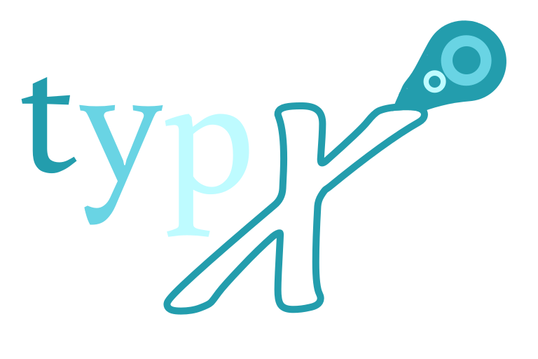
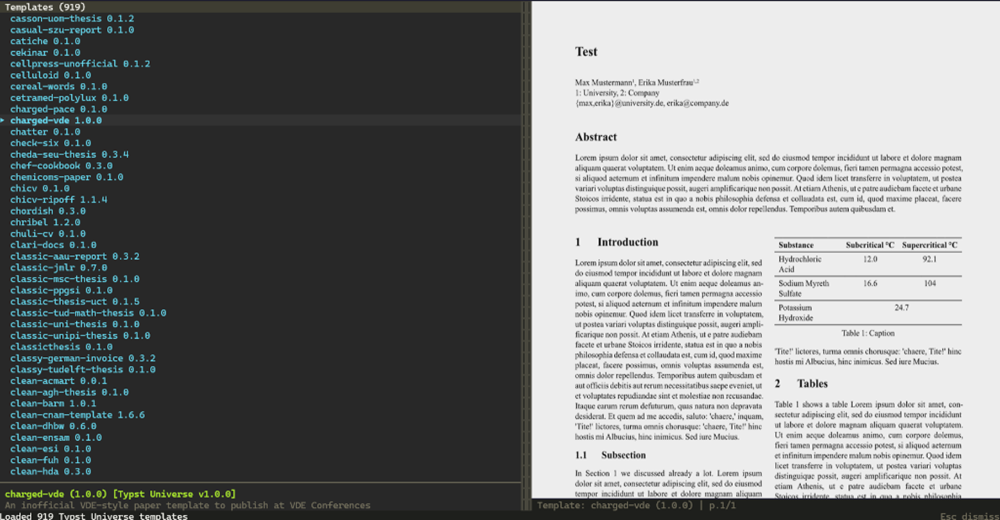

<p align="center">
  
</p>

<h1 align="center">TypX</h1>

<p align="center">
  <a href="https://github.com/monicafaye/TypX/releases"></a>
  <a href="https://typst.app/"></a>
  <a href="LICENSE"></a>
  
</p>

TypX (`typx`) is a terminal editor for [Typst](https://typst.app/), forked from [`zyedidia/micro`](https://github.com/zyedidia/micro). It combines live math concealment, a document outline, `tinymist` LSP integration, and side-by-side live preview in a single Go binary with standard keybindings and no plugin configuration.

<p align="center">
  <br />
  <sub><em>Document Outline (<code>Alt+O</code>), cursor-aware Unicode math concealment (<code>Alt+C</code>), and native in-terminal Sixel live preview (<code>Alt+P</code>) editing <code>@preview/clean-math-paper</code>.</em></sub>
</p>

In-terminal preview is available when your terminal supports either Kitty graphics or Sixel graphics. If your terminal does not support either protocol, TypX falls back to browser preview. See [Terminal compatibility notes](#terminal-compatibility-notes) for supported terminals.

TypX includes:

- **Micro ergonomics.** Standard keybindings (`Ctrl+S`, `Ctrl+C`, `Ctrl+V`, `Ctrl+Z`, `Ctrl+F`), mouse support, splits, tabs, and Lua plugins work out of the box.
- **Typst syntax and themes.** The built-in `typst.yaml` grammar highlights Markup, Math, and Code modes alongside companion formats (`bibtex`, `markdown`, `yaml`, `toml`, `json`, `ini`, `patch`) and built-in dark and light themes (`monokai`, `catppuccin-mocha`, `catppuccin-latte`, `tokyo-night`, `nord`, `rose-pine`, `rose-pine-dawn`, `kanagawa`, `everforest-dark`, `everforest-light`, `github-dark`, `github-light`, `gruvbox-tc`, `gruvbox-light`, `solarized-tc`, `solarized-light`, `dracula-tc`, `one-dark`).
- **Cursor-aware Unicode math concealment.** Non-cursor lines display Greek letters, arrows, relations, set and logic operators, brackets (`angle.l`/`floor.l`/`ceil.l`), big operators, math alphabets (`bb(...)`, `cal(...)`), single and parenthesized super/subscripts (`^2`, `^(n+1)`, `_(i=1)`), and typographic dashes (`---`, `--`, `...`), while the active line stays unconcealed for editing. Concealment never alters the `.typ` file on disk.
- **Structural, math, and citation shortcuts.** Keybindings insert inline or display math (`Alt+M` and `Alt+Shift+M`), bold or italic wrappers (`Alt+B` and `Alt+E`), heading level changes (`Alt+Left` and `Alt+Right`), 3-layer snippet expansion across built-in, user (`<config-dir>/snippets.json`), and project (`<project-root>/.typx/snippets.json`) templates with `Tab` and `Shift+Tab` navigation (`:insert` or `Alt+I`), a mode-aware math symbol picker (`:symbol` or `Alt+Y`, inserting `name` in math mode or `$name$` in markup mode), a bibliography citation picker (`:cite` or `Alt+R`) for BibTeX and Hayagriva YAML with offline `@` suggestions, Typst-aware smart pairs, and markup list continuation on `Enter` for `-`, `+`, `N.`, and `/`.
- **Template Gallery and project creation.** Start documents with `typx --new <template> [path]`, or press `Alt+Shift+N` (or run `:templates`) from any buffer, including an unnamed blank startup buffer, to open a docked gallery of project and personal templates (`.typx/templates/`, `<config-dir>/templates/`), `@local` packages, and on-demand Typst Universe `@preview` templates via `tinymist`, with live Kitty graphics or Sixel visual preview enabled by default while browsing. Save reusable preambles or documents with `:template-save`.
- **Document Outline sidebar.** Press `Alt+O` or run `:outline` to toggle a docked sidebar powered by an incremental Go parser, following `#include "..."` directives from the pinned main file or active file with a `p` key toggle between `[Project]` and `[File]` views, optional `tinymist` `textDocument/documentSymbol` enrichment, cross-file jumps via `typst.gotoOpenMode`, live cursor tracking, and `/` filtering.
- **File Manager sidebar.** Press `Alt+T` or run `:tree` to browse directories, expand folders inline, open files in splits, and run `:touch`, `:mkdir`, `:rename`, and `:rm`.
- **In-terminal and browser preview.** Press `Alt+P` or run `:preview inline` for a right-docked inline preview using the Kitty Graphics Protocol or Sixel with `40%` to `250%` zoom, horizontal panning (`h`/`l`, `0` reset), color inversion, margin trimming, and double-click or `Ctrl+Click` click-to-source, or run `:preview browser` for an auto-reloading browser preview with bidirectional scroll sync.
- **`tinymist` LSP and multi-file projects.** TypX resolves project roots from `typst.toml`, root-relative `/...` imports, `.git`, or `../` imports, and provides `:pin [path]`/`:unpin` main-file pinning (`PIN:` statusline indicator), `:export [pdf|png|svg|html]` (`typst.exportOnSave`), `:format` (`typst.formatOnSave`), go-to-definition across `.typ`/`.bib`/packages (`F12`, `Alt+U` back), find references (`Shift+F12`), cross-file symbol rename (`F2` / `:lsp-rename`), code actions (`Alt+A`), workspace symbol search (`Alt+S`), symbol occurrence highlighting (`typst.documentHighlight`), semantic selection expand/shrink (`Alt+W` / `Alt+Shift+W`), interactive `:diagnostics` drawer (`F8`/`Shift+F8` jump, `/` filter), multi-candidate completion (`Ctrl+Space`, `Tab`/`Shift+Tab` cycle, `Enter` commit and snippet expansion, `Esc` revert), signature help (`Alt+H` or `:signature-help`, auto-triggered on `(` and `,`), and hover docs (`Alt+K` or `:hover`). Pass `--no-lsp` to run offline without `tinymist`.

<p align="center">
  <br />
  <sub><em>Template Gallery (<code>Alt+Shift+N</code>) browsing Typst Universe packages with live in-terminal Sixel preview.</em></sub>
</p>

---

## Installation

The installer scripts download `typx`, verify its SHA-256 checksum, update `PATH`, and install [tinymist](https://github.com/Myriad-Dreamin/tinymist) if it is missing. TypX uses `tinymist` for live preview, diagnostics, completion, and PDF export.

### Windows

Run this command in [Windows Terminal](https://apps.microsoft.com/detail/9n0dx20hk701) or PowerShell:

```powershell
irm https://raw.githubusercontent.com/monicafaye/TypX/main/scripts/install.ps1 | iex
```

Or install with Scoop:

```powershell
scoop bucket add monicafaye https://github.com/monicafaye/scoop-bucket
scoop bucket add typst-community https://github.com/typst-community/scoop-bucket
scoop install monicafaye/typx typst-community/tinymist
```

### macOS

```bash
curl -fsSL https://raw.githubusercontent.com/monicafaye/TypX/main/scripts/install.sh | sh
```

Or install with Homebrew:

```bash
brew install monicafaye/tap/typx tinymist
```

### Linux

```bash
curl -fsSL https://raw.githubusercontent.com/monicafaye/TypX/main/scripts/install.sh | sh
```

[GitHub Releases](https://github.com/monicafaye/TypX/releases) also provides `.deb` and `.rpm` packages for `amd64` and `arm64`:

```bash
# Debian or Ubuntu
sudo apt install ./typx_*_amd64.deb

# Fedora, RHEL, or openSUSE
sudo dnf install ./typx-*.x86_64.rpm

# tinymist
curl --proto '=https' --tlsv1.2 -LsSf https://github.com/Myriad-Dreamin/tinymist/releases/latest/download/tinymist-installer.sh | sh
```

Open a new terminal window and verify both `typx` and `tinymist`:

```bash
typx --check
```

<details>
<summary>Manual download, Go install, and building from source</summary>

#### Prebuilt archives

[GitHub Releases](https://github.com/monicafaye/TypX/releases) publishes archives for `windows/amd64`, `windows/arm64`, `darwin/arm64`, `darwin/amd64`, `linux/amd64`, and `linux/arm64`, along with `SHA256SUMS.txt`. Extract `typx`, or `typx.exe` on Windows, onto your `PATH`. Install `tinymist` from [tinymist releases](https://github.com/Myriad-Dreamin/tinymist/releases) or via a package manager:

- Windows: `winget install Myriad-Dreamin.Tinymist`
- macOS: `brew install tinymist`
- Linux: `curl --proto '=https' --tlsv1.2 -LsSf https://github.com/Myriad-Dreamin/tinymist/releases/latest/download/tinymist-installer.sh | sh`

Package manager manifests for Scoop, Homebrew, `.deb`, `.rpm`, and AUR live in [packaging/](packaging/README.md).

#### Using Go

Install Go 1.23 or newer first. This command installs `typx` into `$GOBIN` or `$GOPATH/bin`. Install `tinymist` separately.

```bash
go install github.com/monicafaye/TypX/cmd/typx@latest
```

#### Building from source

Install Go 1.23 or newer first:

```bash
git clone https://github.com/monicafaye/TypX
cd TypX
go generate ./runtime
go build -trimpath ./cmd/typx
```

Or use `make`, which runs `go generate ./runtime` and embeds the version, commit hash, and compile date:

```bash
make build      # builds ./typx (or typx.exe on Windows)
make install    # installs to $GOBIN or $GOPATH/bin
```

#### Cross-platform builds

TypX embeds all runtime assets via `go:embed` and compiles with `CGO_ENABLED=0`:

```bash
go generate ./runtime

# Windows (amd64 / arm64)
GOOS=windows GOARCH=amd64 CGO_ENABLED=0 go build -trimpath -o binaries/typx-windows-amd64.exe ./cmd/typx
GOOS=windows GOARCH=arm64 CGO_ENABLED=0 go build -trimpath -o binaries/typx-windows-arm64.exe ./cmd/typx

# Linux (amd64 / arm64)
GOOS=linux GOARCH=amd64 CGO_ENABLED=0 go build -trimpath -o binaries/typx-linux-amd64 ./cmd/typx
GOOS=linux GOARCH=arm64 CGO_ENABLED=0 go build -trimpath -o binaries/typx-linux-arm64 ./cmd/typx

# macOS (Apple Silicon / Intel)
GOOS=darwin GOARCH=arm64 CGO_ENABLED=0 go build -trimpath -o binaries/typx-darwin-arm64 ./cmd/typx
GOOS=darwin GOARCH=amd64 CGO_ENABLED=0 go build -trimpath -o binaries/typx-darwin-amd64 ./cmd/typx
```

Run `make build-cross` to build all six targets at once.

</details>

<details>
<summary>Installer options and tinymist configuration</summary>

#### Installer script variables

- `TYPX_INSTALL_DIR` sets the install directory. Defaults are `%LOCALAPPDATA%\TypX\bin` on Windows and `~/.local/bin` on macOS and Linux.
- `TYPX_SKIP_TINYMIST=1` skips installing `tinymist`.
- `TYPX_NO_MODIFY_PATH=1` skips editing `PATH` or shell profiles.

#### Installing `tinymist` separately

- Windows: `winget install Myriad-Dreamin.Tinymist`, `scoop install typst-community/tinymist`, or `cargo install --locked tinymist`
- macOS: `brew install tinymist` or `cargo install --locked tinymist`
- Linux: `curl --proto '=https' --tlsv1.2 -LsSf https://github.com/Myriad-Dreamin/tinymist/releases/latest/download/tinymist-installer.sh | sh`, `cargo install --locked tinymist`, or a binary from [tinymist releases](https://github.com/Myriad-Dreamin/tinymist/releases)

#### Automatic discovery order

TypX searches for `tinymist` on macOS and Linux, or `tinymist.exe` on Windows, in this order:

1. `typst.tinymistPath` in `settings.json`, or `-typst.tinymistPath <path>` on the command line.
2. `PATH`.
3. Standard OS locations:
   - Windows: `%USERPROFILE%\.local\bin`, `%USERPROFILE%\.cargo\bin`, `%LOCALAPPDATA%\Microsoft\WinGet\Links`, `%USERPROFILE%\scoop\shims`, and installed VS Code `myriad-dreamin.tinymist` extensions.
   - macOS: `/opt/homebrew/bin`, `/usr/local/bin`, `~/.cargo/bin`, `~/.local/bin`, and VS Code extensions.
   - Linux: `~/.cargo/bin`, `~/.local/bin`, `/usr/local/bin`, `/usr/bin`, and VS Code extensions.

Inside TypX, press `Ctrl+E` and run `tinymist-status` to inspect the active binary, or run `tinymist-restart` to restart the server. Pass `--no-lsp` to edit offline without `tinymist`.

</details>

---

## Quick start and CLI usage

Open any `.typ` document with TypX:

```bash
typx paper.typ                   # open with LSP, math concealment, and outline
typx --new list                  # list available project, personal, and cached templates
typx --new my-notes hw3.typ      # create hw3.typ from a personal/project template and open it
typx --new @preview/charged-ieee # scaffold a Typst Universe template project into ./charged-ieee
typx --no-lsp paper.typ          # offline mode without starting tinymist
typx --preview paper.typ         # open file and start live preview
```

### CLI flags

| Flag | Description |
|---|---|
| `--check` | Verify config directory, embedded Typst syntax, Unicode and Kitty or Sixel terminal capability, and `tinymist` discovery and version, then exit. |
| `--new <tmpl>` | Scaffold a document or project from a template (`--new list` lists offline/cached templates) and open it. |
| `--no-lsp` | Launch without starting `tinymist` (offline mode). |
| `--preview` | Start live preview on the opened `.typ` file (inline Kitty/Sixel or browser per `typst.previewMode`). |
| `--version` | Show TypX version, upstream `micro` base version, commit hash, and compile date. |
| `--options` | List all configuration options and their default values. |
| `-config-dir <dir>` | Use a custom configuration directory for this session. |
| `-<option> <value>` | Override any option for this session (for example, `typx -colorscheme catppuccin-mocha paper.typ`). |
| `+LINE[:COL]` | Open buffer positioned at a specific line and optional column. |

---

## Default keybindings and commands

Press `Ctrl+E` to open the command bar (`>` prompt). Most TypX keybindings apply in `.typ` buffers and fall back to standard `micro` actions in other file types; `Alt+Shift+N` (`:templates`) and `Alt+T` (`:tree`) work in any buffer. All bindings can be customized in `bindings.json`.

### TypX and Typst shortcuts

| Feature | Command | Default Keybinding | Description |
|---|---|---|---|
| Live Preview | `:preview [inline\|kitty\|sixel\|browser\|focus\|page <n>\|sync\|invert\|trim\|stop]` | `Alt+P` | Toggle live preview (`auto` chooses Kitty graphics or Sixel when supported, otherwise browser preview), jump to a page, or toggle cursor sync. |
| Document Outline | `:outline` | `Alt+O` | Toggle the docked Document Outline sidebar. |
| File Manager | `:tree` | `Alt+T` | Toggle the built-in file tree sidebar (`:touch`, `:mkdir`, `:rename`, `:rm`). |
| Math Concealment | `:conceal [on\|off]` | `Alt+C` | Toggle live Unicode math and symbol concealment in the active buffer. |
| Inline Math | `:math-inline` | `Alt+M` | Insert `$|$`, wrap selection in `$...$`, or exit inline math. |
| Display Math | `:math-display` | `Alt+Shift+M` | Insert a multi-line display math block `$\n  |\n$`. |
| Insert Snippet | `:insert [name]` | `Alt+I` | Open the filterable snippet picker across built-in, user (`<config-dir>/snippets.json`), and project (`<project-root>/.typx/snippets.json`) snippets, or expand a named snippet. |
| Math Symbol Picker | `:symbol [query]` | `Alt+Y` | Open the filterable math symbol catalog and insert `name` in math mode or `$name$` in markup mode. |
| Citation Picker | `:cite [query]` | `Alt+R` | Search local BibTeX (`.bib`) and Hayagriva YAML (`.yml`, `.yaml`) entries by key, author, title, or year and insert `@key`. |
| Template Gallery | `:templates` | `Alt+Shift+N` | Toggle the docked Template Gallery sidebar (works in any buffer; includes project/personal, `@local`, and Typst Universe `@preview`). |
| Apply Template | `:template [name] [dir\|--preamble]` | None | Insert a personal or project template, create a multi-file or `@preview` project, or insert its preamble. |
| Save Template | `:template-save <name> [--preamble]` | None | Save the active buffer or preamble into `<config-dir>/templates/<name>.typ`. |
| Bold | `:wrap-bold` | `Alt+B` | Wrap selection or insert `*bold*` delimiters. |
| Italic | `:wrap-italic` | `Alt+E` | Wrap selection or insert `_italic_` delimiters. |
| Promote Heading | `:heading-promote` | `Alt+Left` | Decrease heading level (`== ` to `= `). |
| Demote Heading | `:heading-demote` | `Alt+Right` | Increase heading level (`= ` to `== `). |
| LSP Completion | `:lsp-complete` | `Ctrl+Space` | Trigger `tinymist` autocomplete (auto-suggests on `#`, `@`, `.`, and `<`; press `Tab` or `Shift+Tab` to cycle, `Enter` to commit and expand snippets, or `Esc` to revert; uses local bibliography entries on `@` when offline). |
| LSP Hover | `:hover` | `Alt+K` | Show `tinymist` documentation or type info at cursor. |
| Signature Help | `:signature-help` | `Alt+H` | Show active function parameters from `tinymist` in the infobar (also triggers automatically on `(` and `,`). |
| Go to Definition | `:definition` | `F12` | Jump to definition across `.typ`, `.bib`, and read-only `@preview` packages. |
| Find References | `:references` | `Shift+F12` | List and jump to symbol references across the workspace (`/` filters). |
| Jump Back | `:jump-back` | `Alt+U` | Return to the previous location on the tab's definition jump stack. |
| Rename Symbol | `:lsp-rename [new]` | `F2` | Rename the symbol at cursor across open and workspace `.typ` files (with `prepareRename`). |
| Code Actions | `:code-action` | `Alt+A` | List and apply `tinymist` quickfixes, refactors, and server commands. |
| Workspace Symbols | `:symbols [query]` | `Alt+S` | Search and jump to symbols across the Typst workspace (`/` filters live). |
| Expand Selection | `:select-expand` | `Alt+W` | Expand selection to the next enclosing syntax range via `tinymist`. |
| Shrink Selection | `:select-shrink` | `Alt+Shift+W` | Restore the previous selection from the per-pane selection stack. |
| Next / Prev Diagnostic | `:diag-next`, `:diag-prev` | `F8`, `Shift+F8` | Cycle across diagnostics in the current buffer with wrap-around. |
| Diagnostics Drawer | `:diagnostics` | None | Open the bottom interactive diagnostics drawer (`f` filters errors only, `/` filters text, `Enter` jumps). |
| Pin / Unpin Main | `:pin [path]`, `:unpin` | None | Pin or unpin the project's main `.typ` file for LSP, preview, and `:export`. |
| Export Document | `:export [pdf\|png\|svg\|html] [output]` | None | Export the active or pinned document via `tinymist compile`. |
| Format Document | `:format` | None | Format the active `.typ` buffer via `tinymist` with single-step undo. |
| Tinymist Status | `:tinymist-status` | None | Display `tinymist` binary path, LSP state, pinned main, preview URL, and stderr tail. |
| Restart Tinymist | `:tinymist-restart` | None | Restart the `tinymist` language server subprocess. |

Direct snippet commands are registered for the 10 built-in names (`:insert-figure`, `:insert-table`, `:insert-frac`, `:insert-matrix`, `:insert-cases`, `:insert-code`, `:insert-callout`, `:insert-vec`, `:insert-hat`, and `:insert-bar`) and pick up user or project overrides with the same name. Custom user or project snippet names run via `:insert <name>` or `Alt+I`.

### In-terminal preview navigation

When the right-docked inline preview pane (Kitty graphics or Sixel) is focused via `:preview inline`, `:preview kitty`, `:preview sixel`, or `:preview focus`:

| Key or Action | Behavior |
|---|---|
| `Up` / `Down`, `k` / `j`, `w` / `s`, Mouse Wheel | Scroll up or down through pages. |
| `PgUp` / `PgDn`, `Ctrl+U` / `Ctrl+D`, `Space` | Page up or down through the document. |
| `[` / `]` | Jump to previous or next page. |
| `Left` / `Right` | Pan horizontally when zoomed past `100%`, or jump to previous or next page at `100%` or below. |
| `h` / `l` or Horizontal Mouse Wheel | Pan left or right when zoomed wider than the pane. |
| `g` / `G` or `Home` / `End` | Jump to top or bottom of document. |
| `+` / `-` | Zoom preview in or out (`40%` to `250%`). |
| `0` | Reset zoom to `100%` and horizontal scroll to `0`. |
| `Double-Click` or `Ctrl+Click` | Jump editor cursor to the clicked source line and focus the editor. |
| `<` / `>` | Widen or narrow the docked preview pane. |
| `t` | Toggle dark-mode color inversion (`typst.previewInvert`). |
| `m` | Toggle page margin trimming (`typst.previewTrimMargins`). |
| `f` | Toggle cursor-to-preview scroll sync (`typst.previewSyncCursor`). |
| `r` | Force recompile and redraw preview. |
| `Esc`, `Enter`, `Tab`, `Ctrl+W` | Return focus to the editor pane. |
| `q` or `Alt+P` | Close the preview pane. |

### Document Outline navigation

When the Document Outline sidebar (`Alt+O`) is focused:

| Key or Action | Behavior |
|---|---|
| `Up` / `Down` or `k` / `j` | Move selection through headings, figures, and optional labels. |
| `Home` / `End` / `PgUp` / `PgDn` | Jump to top, bottom, or page through the outline. |
| `Enter` or Mouse Click | Jump the linked editor pane to that item, center the view, and return focus to the editor. |
| `p` | Toggle between multi-file `[Project]` view and current-file `[File]` view. |
| `/` | Filter outline entries (`Esc` clears filter, `Enter` confirms). |
| `Esc` or `Tab` | Return focus to the editor without jumping. |
| `Alt+O` or `:outline` | Close the outline sidebar. |

### Template Gallery navigation

When the Template Gallery (`Alt+Shift+N` / `:templates`) is focused:

| Key or Action | Behavior |
|---|---|
| `Up` / `Down` or `k` / `j` | Move selection across Project & Personal, Local & Cached, and Typst Universe rows. |
| `Enter` or Click | Apply personal or project template (inserts into a blank `.typ` or unnamed buffer and sets `typst` filetype, prompts insert vs. new tab on non-empty `.typ` buffers, opens a new `.typ` tab on non-Typst or read-only files), or create a multi-file/`@preview` project. |
| `v` | Toggle live in-terminal preview (on by default in Kitty graphics or Sixel terminals, or a read-only `.typ` source split otherwise). |
| `p` | Insert preamble (`--preamble`) or package entrypoint at line 1 of an editable `.typ` or unnamed buffer (or open it in a new `.typ` tab otherwise). |
| `n` | Prompt for a target directory and scaffold a new project folder. |
| `u` | Load or refresh the online Typst Universe (`@preview`) catalog on demand. |
| `/` or `Ctrl+F` | Search templates by name, description, category, tags, or author (supports multi-word queries, fuzzy name matching, and `cat:`/`tag:`/`author:`/`src:` qualifiers; `Tab` browses results, `Ctrl+U` clears input, `Esc` clears search, `Enter` applies). Click the search bar or run `:templates search [query]`. |
| `Esc` or `Tab` | Return focus to the editor. |
| `q` or `Alt+Shift+N` | Close the Template Gallery sidebar. |

---

## Configuration

TypX resolves its configuration directory in this order:

1. `$TYPX_CONFIG_HOME` (if set)
2. `<os.UserConfigDir()>/typx` (for example, `%APPDATA%\typx` on Windows, `~/Library/Application Support/typx` on macOS, or `$XDG_CONFIG_HOME/typx` / `~/.config/typx` on Linux)
3. Fallback: `~/.config/typx`

### TypX options in `settings.json`

| Option | Scope | Default | Description |
|---|---|---|---|
| `typst.conceal` | local/global | `true` | Enable live Unicode math and typography concealment in `.typ` buffers. |
| `typst.concealMode` | local/global | `"line"` | Unconceal policy: `"line"` unconceals the active cursor line, and `"token"` unconceals only the token under the cursor. |
| `typst.smartPairs` | local/global | `true` | Typst-aware smart pairing, skip-over, pair-backspace (`$`, `[`, `(`, `{`, `"`), and markup list continuation on `Enter` (`-`, `+`, `N.`, `/`). |
| `typst.keyHints` | global | `true` | Show the context-aware, clickable shortcut hint bar on the bottom row and prompt helper hints. |
| `typst.lspEnabled` | global | `true` | Enable `tinymist` LSP integration (`false` is equivalent to `--no-lsp`). |
| `typst.autoComplete` | global | `true` | Show non-mutating `tinymist` completion suggestions in the statusline when typing `#`, `@`, `.`, or `<`, and offline `@` citation suggestions from local bibliography files when `tinymist` is off or missing. |
| `typst.documentHighlight` | global | `true` | Highlight matching occurrences of the symbol under the cursor via `tinymist`. |
| `typst.signatureHelp` | global | `true` | Show `tinymist` function parameter hints in the infobar when typing `(` or `,`. |
| `typst.tinymistPath` | global | `""` | Explicit path to `tinymist` or `tinymist.exe` (empty uses auto-discovery). |
| `typst.debounceMs` | global | `150` | Debounce interval in milliseconds for `textDocument/didChange` updates. |
| `typst.previewMode` | global | `"auto"` | Live preview mode: `"auto"` (inline Kitty or Sixel when supported, else browser), `"inline"`, or `"browser"`. |
| `typst.previewProtocol` | global | `"auto"` | Inline preview graphics protocol: `"auto"` (prefers Kitty over Sixel), `"kitty"`, or `"sixel"`. |
| `typst.previewWidth` | global | `48` | Preferred width percentage for the docked in-terminal preview pane. |
| `typst.previewPPI` | global | `144` | Render resolution (PPI) for in-terminal preview pages. |
| `typst.previewInvert` | global | `false` | Invert colors in the in-terminal preview for dark terminals. |
| `typst.previewTrimMargins` | global | `false` | Trim excess outer page margins in the in-terminal preview. |
| `typst.previewSyncCursor` | global | `false` | Follow editor cursor line movements in the in-terminal preview (toggle live with `f` or `:preview sync`). |
| `typst.previewOpenBrowser` | global | `true` | Open the local preview URL in the OS browser when browser preview starts. |
| `typst.outlineWidth` | global | `30` | Preferred width in columns for the Document Outline sidebar (auto-hides if terminal width `< 50`). |
| `typst.outlineShowLabels` | global | `false` | Include standalone `<label>` anchors in the Document Outline alongside headings and figures. |
| `typst.templatesWidth` | global | `36` | Preferred width in columns for the Template Gallery sidebar (auto-hides if terminal width `< 50`). |
| `typst.exportOnSave` | global | `"off"` | Auto-export `.typ` buffers on explicit save (`"off"`, `"pdf"`, `"png"`, `"svg"`, `"html"`). |
| `typst.formatOnSave` | global | `false` | Format `.typ` buffers via `tinymist` before explicit save (falls back to saving after 1s timeout). |
| `typst.formatter` | global | `"typstyle"` | Typst formatter backend passed to `tinymist` (`"typstyle"`, `"typstfmt"`, `"disable"`). |
| `typst.gotoOpenMode` | global | `"tab"` | How `:definition`, `:references`, `:symbols`, `:diagnostics`, cross-file Document Outline jumps, and browser preview reverse sync open unopened targets (`"tab"`, `"vsplit"`, `"current"`). |
| `typst.listPaneHeight` | global | `10` | Preferred row height for bottom-docked drawers (`:diagnostics`, multi-target `:definition`, `:references`, `:code-action`, `:symbols`, `:insert`, `:symbol`, and `:cite`). |

Example `settings.json`:

```json
{
  "colorscheme": "catppuccin-mocha",
  "typst.conceal": true,
  "typst.concealMode": "line",
  "typst.previewMode": "auto",
  "typst.previewInvert": true,
  "typst.outlineWidth": 32,
  "typst.outlineShowLabels": false
}
```

### Built-in `.typ` filetype defaults

When editing `.typ` files, TypX applies these defaults unless overridden globally or in an `"ft:typst"` block in `settings.json`:

- `softwrap: true`, `wordwrap: true`
- `tabstospaces: true`, `tabsize: 2`
- `autoindent: true`, `ruler: true`
- TypX statusline showing Typst lexical mode (`MARKUP`, `MATH`, `CODE`, or `RAW`), word count, and `tinymist` LSP or Preview status (`LSP: ready`, `LSP: no tinymist`, `LSP: off`, `PREVIEW: ON`).

### Colorschemes

Switch themes via `Ctrl+E` (press `Tab` to list all embedded themes, or run `> help colors`):

```text
> set colorscheme catppuccin-mocha
> set colorscheme tokyo-night
> set colorscheme github-light
```

The default theme is `default` (`monokai`). Dark themes with full Typst and UI styling include `catppuccin-mocha`, `tokyo-night`, `nord`, `rose-pine`, `kanagawa`, `everforest-dark`, `github-dark`, `dracula-tc`, `gruvbox-tc`, `one-dark`, `solarized-tc`, and `monokai`. Light themes include `github-light`, `catppuccin-latte`, `gruvbox-light`, `solarized-light`, `rose-pine-dawn`, and `everforest-light`.

---

## Terminal compatibility notes

- **Windows.** Use [Windows Terminal](https://apps.microsoft.com/detail/9n0dx20hk701) (Sixel) or WezTerm (Kitty graphics and Sixel), with a Unicode-capable font such as Cascadia Mono, JetBrains Mono, Iosevka, or JuliaMono for full math glyph rendering.
- **macOS.** Use a terminal with Kitty graphics or Sixel support such as Ghostty, Kitty, WezTerm, or iTerm2 for in-terminal preview. Other terminals fall back to browser preview. Configure the Option key to act as Meta/Alt so `Alt+*` shortcuts work:
  - In iTerm2, open Preferences, Profiles, Keys, and set Left Option Key to `Esc+`.
  - In Terminal.app, open Preferences, Profiles, Keyboard, and enable Use Option as Meta key.
- **Linux.** In-terminal preview works in terminals with Kitty graphics or Sixel support such as Kitty, Ghostty, WezTerm, Konsole, foot, and xterm with Sixel enabled. Inside `tmux`, enable `set -g allow-passthrough on` to allow Kitty graphics passthrough to the outer terminal. Install `wl-clipboard` on Wayland, or `xclip` or `xsel` on X11, for system clipboard integration.

---

## Built-in documentation

Inside TypX, press `Ctrl+E` and run `help` or open a specific topic:

- `> help typst` opens the TypX authoring guide covering `tinymist`, `:preview`, `:outline`, `:conceal`, shortcuts, and options.
- `> help filemanager` documents the built-in file tree sidebar commands, keybindings, and options.
- `> help defaultkeys` lists default TypX and editor keybindings.
- `> help commands` lists all command-bar commands.
- `> help options` lists all global, local, and `typst.*` configuration options.
- `> help colors` lists all built-in dark, light, 256-color, and 16-color themes.
- `> help keybindings` explains how to customize `bindings.json` and bindable actions.
- `> help tutorial` walks through basic configuration.

---

## Architecture and contributing

- [ARCHITECTURE.md](ARCHITECTURE.md) describes the system diagram, package layout, and subsystem designs, including the concealment coordinate mapper, `tinymist` JSON-RPC client, Kitty and Sixel preview renderer, Template Gallery, and incremental outline parser.
- [AGENTS.md](AGENTS.md) lists build and test commands (`go generate ./runtime`, `go test ./...`, `CGO_ENABLED=1 go test -race ./...`) and architectural invariants.

---

## Credits and license

TypX is licensed under the [MIT License](LICENSE).

TypX is derived from [zyedidia/micro](https://github.com/zyedidia/micro) (`v2.0.15`), whose original code is licensed under the MIT License in [LICENSE-MICRO](LICENSE-MICRO), and uses [tinymist](https://github.com/Myriad-Dreamin/tinymist) for Typst language intelligence and live preview. See [LICENSE-THIRD-PARTY](LICENSE-THIRD-PARTY) for third-party dependency licenses.
